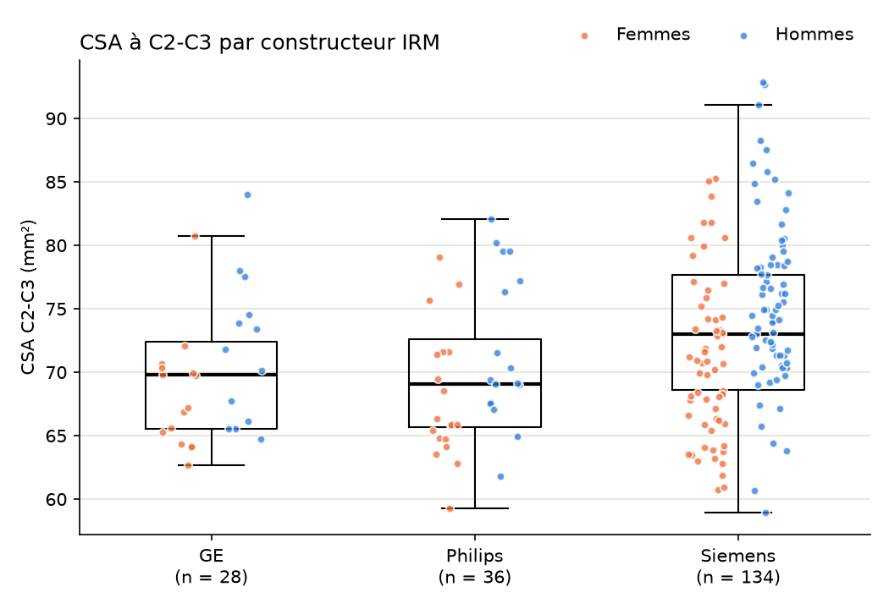

# spinegeneric-csa-biomarker

**Résumé (FR) :** Je calcule l'aire de section de la moelle cervicale (CSA) à C2-C3 avec la Spinal Cord Toolbox sur les sujets sains du dataset public spine-generic. J'étudie ce qui fait varier le CSA (âge, sexe, taille, constructeur IRM, site) avec un modèle mixte, puis je compare des méthodes de normalisation. C'est une reproduction indépendante, avec SCT 7.3, d'analyses déjà publiées par NeuroPoly.

## About

Spinal cord CSA is an MRI biomarker of atrophy in multiple sclerosis, but it varies a lot between healthy people. In this project I:

1. compute the mean CSA between C2 and C3 for all subjects of the Spine Generic dataset
2. study which factors explain CSA variability (linear mixed model)
3. compare normalization methods to reduce this variability

## Data

- Spine Generic Public Database (Multi-Subject): https://github.com/spine-generic/data-multi-subject (commit `0ef57a7f9052ec96c141d59d06beb159883ce269`), described in Cohen-Adad et al. 2021
- 267 participants recruited as healthy volunteers, 42 sites, 3 manufacturers (Siemens, GE, Philips)
- T2w images, with the spinal cord segmentations and disc labels from `derivatives/labels`

**Exclusions (69 subjects, 198 kept):**
- 7 subjects from the official `exclude.yml` (section `csa_t2`: site beijingVerio, motion, repositioning)
- 64 subjects with `pathology` other than `HC` in `participants.tsv` (62 mild cord compressions, 2 myelopathies), as in Valošek et al. 2024

**Quality control:** I checked the 267 segmentations visually with the SCT QC report (`results/qc/qc_report.json`). All were correct.

## Tools

- Spinal Cord Toolbox (SCT) 7.3 (De Leener et al., 2017)
- git-annex (to download the data)
- Git Bash (Windows)
- FSLeyes (to look at the images)
- Python 3.11 (pandas, statsmodels, matplotlib), environment in `environment.yml`

## How to run

Run the commands from the repository folder, and replace `<path_to_...>` with your own paths.

```bash
# 1. CSA for each subject
sct_run_batch -script scripts/process_data.sh -path-data <path_to_data-multi-subject> -path-output <path_to_output> -jobs 4
# then merge the per-subject CSV files into results/csa_c2c3_all.csv

# 2. Statistics
conda env create -f environment.yml
conda activate csa
python analysis/01_descriptive.py <path_to_data-multi-subject>   # exclusions + descriptive stats
python analysis/02_mixed_model.py                                 # mixed model
python analysis/03_normalization.py                               # normalization
```

## Results

### Descriptive (198 subjects)

CSA C2-C3 = 72.3 ± 6.8 mm², coefficient of variation (CV) = 9.4 %



### What explains CSA variability?

Linear mixed model: `CSA ~ age + sex + manufacturer`, then the same model with height added. Site is a random effect (reference: female, Siemens).

| Effect | Without height (n = 198) | With height (n = 196) |
|---|---|---|
| Male | +4.3 mm² [2.7, 6.0], p < 0.001 | +1.5 mm² [-0.8, 3.8], p = 0.20 |
| GE | -3.4 mm² [-6.3, -0.5], p = 0.023 | -2.8 mm² [-5.8, 0.2], p = 0.067 |
| Philips | -3.3 mm² [-5.9, -0.7], p = 0.013 | -3.2 mm² [-5.8, -0.7], p = 0.014 |
| Age (per year) | +0.05 mm² [-0.11, 0.21], p = 0.55 | +0.06 mm² [-0.10, 0.22], p = 0.47 |
| Height (per cm) | - | +0.21 mm² [0.09, 0.33], p = 0.001 |

- Height improves the model (AIC 1282.5 → 1273.4).
- The difference between males and females is mostly explained by height.
- Siemens gives a larger CSA than Philips. GE is also lower than Siemens without height, but not significantly once height is added (p = 0.067). Valošek et al. 2024 also found a larger CSA with Siemens than with GE and Philips.
- No age effect between 19 and 56 years.
- Site explains 7.5 % of the variance (ICC) once manufacturer is in the model.

Note: Bédard & Cohen-Adad 2022 measured spinal cord CSA at C2-C3 on brain T1w MRI from UK Biobank (804 participants aged 48 to 80, older than in spine-generic). Height was weakly correlated with CSA, but it was not kept in their final normalization model, which used brain volume, thalamus volume and sex. I did not have brain volume here.

### Normalization

CSA corrected for height and/or manufacturer using the coefficients of the mixed model (196 subjects with known height). CV computed with 5-fold cross-validation (each subject is corrected by a model fitted without it).

| Method | CV (cross-validated) | Reduction |
|---|---|---|
| Raw | 9.40 % | - |
| Manufacturer | 9.06 % | -4 % |
| Height | 8.68 % | -8 % |
| Height + manufacturer | 8.40 % | -11 % |

- Correcting for height and manufacturer reduces the CV by 11 %.
- Direct and cross-validated CV differ by 0.1 point at most, so there is no overfitting.
- Correcting for manufacturer alone strongly reduces the variance between sites (5.12 → 0.06). With height + manufacturer, it goes back up to 2.62, maybe because some sites (e.g. Tokyo) have shorter subjects. These site variances are imprecise (42 sites, often 2 to 5 subjects), so I do not draw a strong conclusion.

## Limitations

- Each site has only one manufacturer, so the manufacturer effect is partly mixed with differences between sites (population, settings).
- Some sites have only 2 subjects after exclusions.
- Height and sex are strongly related, which makes their effects harder to separate.

## Related work

- Pipeline of the dataset: https://github.com/spine-generic/spine-generic
- CSA normalization: https://github.com/sct-pipeline/ukbiobank-spinalcord-csa

## References

- Cohen-Adad J. et al. (2021). Open-access quantitative MRI data of the spinal cord and reproducibility across participants, sites and manufacturers. *Scientific Data*, 8, 219. https://doi.org/10.1038/s41597-021-00941-8
- Valošek J., Bédard S. et al. (2024). A database of the healthy human spinal cord morphometry in the PAM50 template space. *Imaging Neuroscience*, 2. https://doi.org/10.1162/imag_a_00075
- Bédard S., Cohen-Adad J. (2022). Automatic measure and normalization of spinal cord cross-sectional area using the pontomedullary junction. *Frontiers in Neuroimaging*, 1. https://doi.org/10.3389/fnimg.2022.1031253
- De Leener B. et al. (2017). SCT: Spinal Cord Toolbox, an open-source software for processing spinal cord MRI data. *NeuroImage*, 145, 24-43. https://doi.org/10.1016/j.neuroimage.2016.10.009
